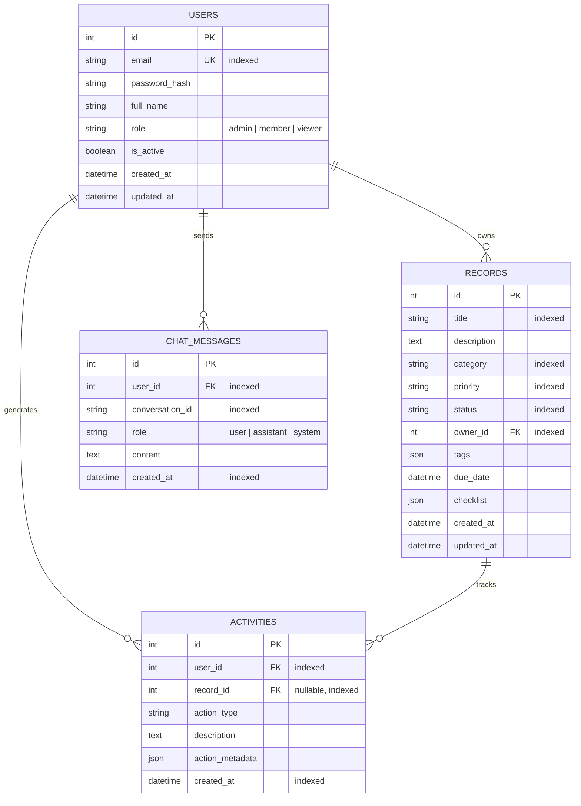

# ATLAS Workspace — Database Architecture & Schema

This document details the relational data model, indexing strategy, foreign key constraints, and migration workflows for **ATLAS Workspace**.

---

## 1. Relational Architecture & ERD

The database supports normalized persistence with cascading referential integrity.



---

## 2. Table Definitions

### Table: `users`
Represents workspace user accounts, authorization roles, and credential hashes.

| Column | Type | Constraints | Description |
|---|---|---|---|
| `id` | Integer | PRIMARY KEY, AUTO_INCREMENT | Unique user identifier |
| `email` | String(255) | UNIQUE, NOT NULL, INDEXED | Normalized lower-case email address |
| `password_hash` | String(255) | NOT NULL | Argon2 / bcrypt password hash string |
| `full_name` | String(255) | NOT NULL | User's full display name |
| `role` | String(50) | NOT NULL, DEFAULT 'member' | Authorization role (`admin`, `member`, `viewer`) |
| `is_active` | Boolean | NOT NULL, DEFAULT TRUE | Status toggle |
| `created_at` | DateTime | NOT NULL, DEFAULT UTC | Account creation timestamp |
| `updated_at` | DateTime | NOT NULL, DEFAULT UTC | Profile update timestamp |

### Table: `records`
Represents structured workspace items, projects, documents, or operational milestones.

| Column | Type | Constraints | Description |
|---|---|---|---|
| `id` | Integer | PRIMARY KEY, AUTO_INCREMENT | Unique record identifier |
| `title` | String(255) | NOT NULL, INDEXED | Item title |
| `description` | Text | NOT NULL, DEFAULT '' | Full markdown or plain text scope |
| `category` | String(100) | NOT NULL, INDEXED | Category classification |
| `priority` | String(50) | NOT NULL, INDEXED | Priority (`Low`, `Medium`, `High`, `Urgent`) |
| `status` | String(50) | NOT NULL, INDEXED | State (`Draft`, `Open`, `In Progress`, `Completed`, `Archived`) |
| `owner_id` | Integer | FOREIGN KEY (`users.id`), NOT NULL, INDEXED | User ownership relation (CASCADE on delete) |
| `tags` | JSON | NOT NULL, DEFAULT '[]' | Array of string tags |
| `due_date` | DateTime | NULLABLE | Target completion timestamp |
| `checklist` | JSON | NOT NULL, DEFAULT '[]' | Array of `{ id, text, completed }` objects |
| `created_at` | DateTime | NOT NULL, DEFAULT UTC | Creation timestamp |
| `updated_at` | DateTime | NOT NULL, DEFAULT UTC | Modification timestamp |

### Table: `activities`
Audit log recording every state mutation, record lifecycle change, and user export.

| Column | Type | Constraints | Description |
|---|---|---|---|
| `id` | Integer | PRIMARY KEY, AUTO_INCREMENT | Unique audit log ID |
| `user_id` | Integer | FOREIGN KEY (`users.id`), NOT NULL, INDEXED | Author user ID |
| `record_id` | Integer | FOREIGN KEY (`records.id`), NULLABLE, INDEXED | Associated record ID (CASCADE on delete) |
| `action_type` | String(50) | NOT NULL | Action category (`create`, `update`, `status_change`, `delete`, `export`) |
| `description` | Text | NOT NULL | Human-readable audit narrative |
| `action_metadata` | JSON | NOT NULL, DEFAULT '{}' | Structured context dictionary |
| `created_at` | DateTime | NOT NULL, DEFAULT UTC, INDEXED | Timestamp of event |

### Table: `chat_messages`
Stores conversation history between workspace users and the ATLAS Assistant.

| Column | Type | Constraints | Description |
|---|---|---|---|
| `id` | Integer | PRIMARY KEY, AUTO_INCREMENT | Message ID |
| `user_id` | Integer | FOREIGN KEY (`users.id`), NOT NULL, INDEXED | User recipient/author |
| `conversation_id` | String(100) | NOT NULL, INDEXED | Thread / session identifier |
| `role` | String(50) | NOT NULL | Role (`user`, `assistant`, `system`) |
| `content` | Text | NOT NULL | Markdown message content |
| `created_at` | DateTime | NOT NULL, DEFAULT UTC, INDEXED | Message timestamp |

---

## 3. Migration Workflows

Alembic manages schema migrations deterministically.

### Apply Latest Migrations
```powershell
cd backend
python -m alembic upgrade head
```

### Create a New Migration
```powershell
cd backend
python -m alembic revision --autogenerate -m "describe_migration"
```

### Roll Back Previous Migration
```powershell
cd backend
python -m alembic downgrade -1
```

---

## 4. Seeding Demo Data

A deterministic development seeding script is included:

```powershell
cd backend
python -m app.db.seed
```

**Seeded Credentials:**
- Email: `demo@atlasworkspace.io`
- Password: `AtlasDemo2026!`
- Role: `admin` (Alex Mercer)
- Seeded Records: 10 fully populated enterprise records across all categories, priorities, and statuses.
